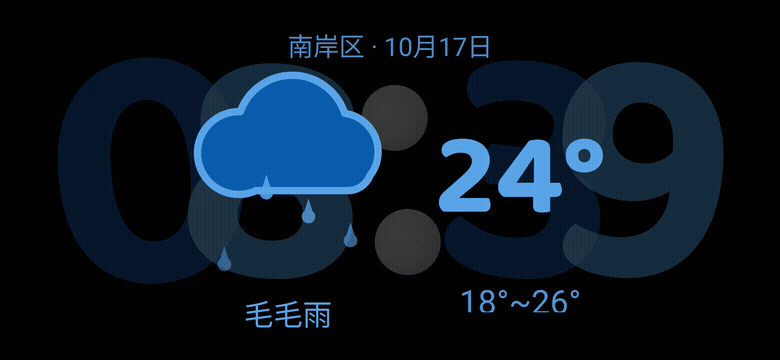
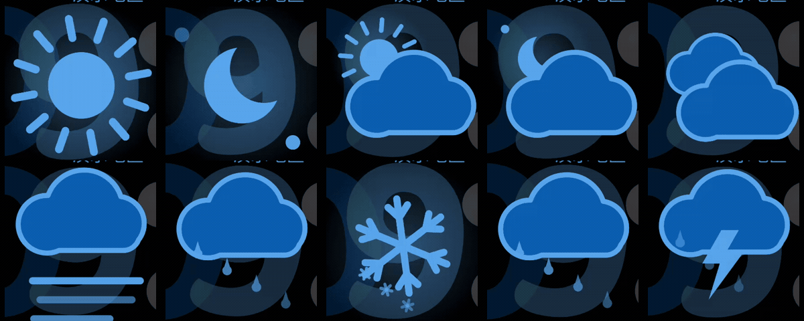
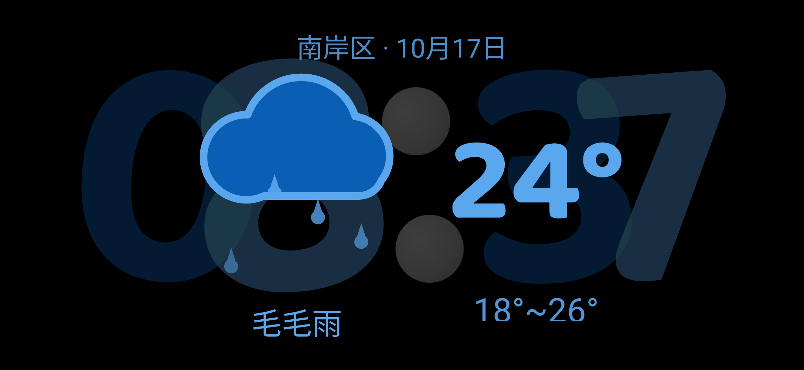
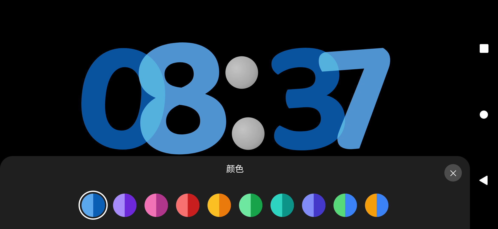
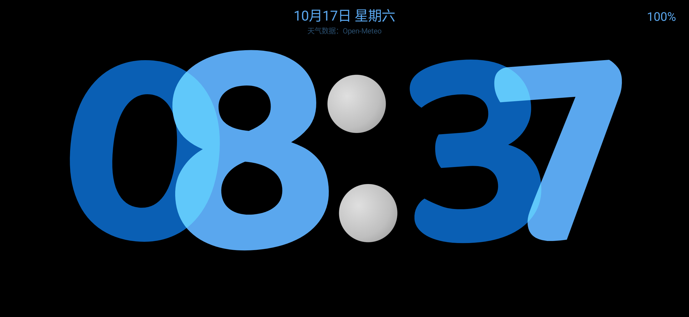
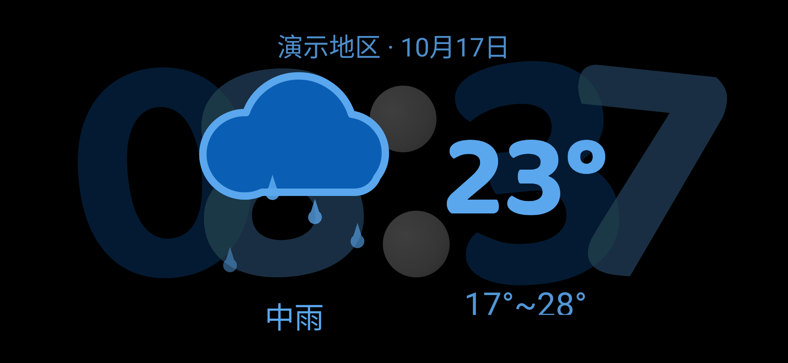
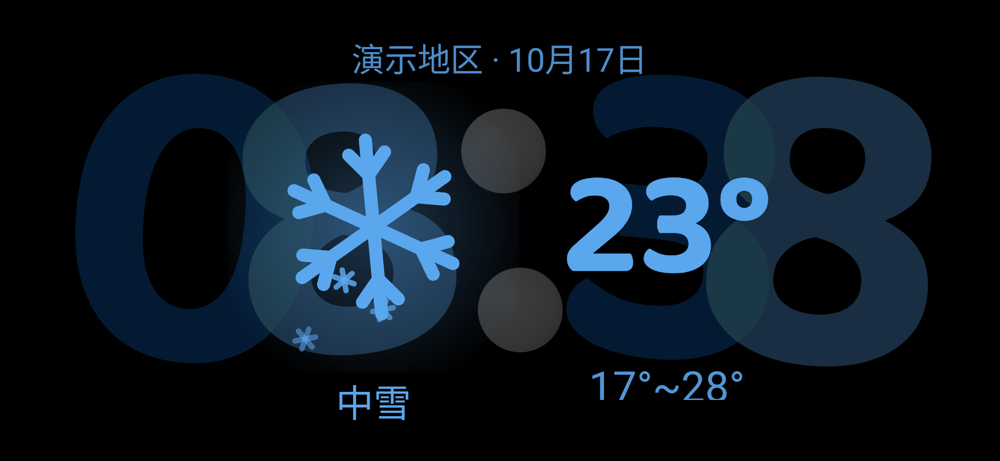
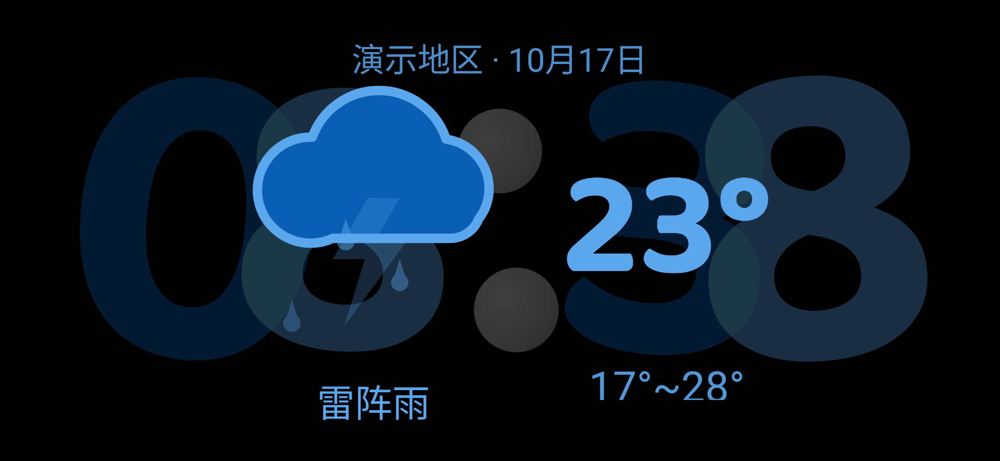
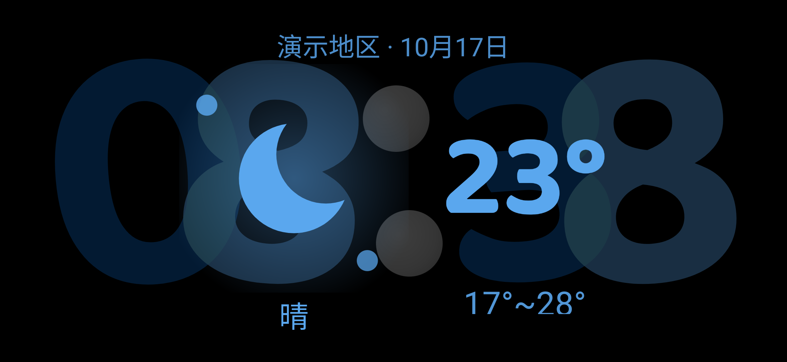
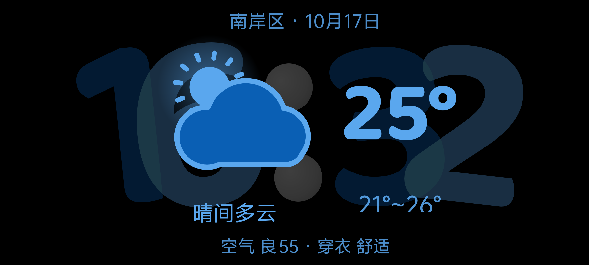

# 数字时钟 · Standby Clock

横屏待机数字时钟 Android 应用。大号翻页时钟 + **手绘动态天气图标** + 10 套配色，UI 全部由 Kotlin 代码构建（**零 XML 布局**）。

无服务、无后台任务、无广告、无统计、无账号 —— 只有一块好看的钟。



> A landscape standby clock for Android with hand-drawn animated weather icons. Pure-code UI (no XML layouts), no services, no analytics, no account.

---

## 功能

| 功能 | 说明 |
| --- | --- |
| **大号翻页时钟** | 4 个数字槽，整分钟切换时逐位翻页；字体 Baloo 2（OFL） |
| **天气面板** | 上下滑呼出：实时温度 + 今日区间 + 中文天气现象 + 动态图标（10 种）；**3 秒后自动回退**为只显示时间 |
| **动态图标** | 晴 / 夜间晴（月牙+星星）/ 多云 / 夜间多云 / 阴 / 雾 / 雨 / 雪 / 雨夹雪 / 雷阵雨，全部 Canvas 实时绘制并有循环动画 |
| **空气质量 · 生活指数** | 可选（启用和风天气后显示 `空气 良 55 · 穿衣 舒适`） |
| **10 套配色** | 长按呼出配色面板，实时预览、选完记住；图标颜色跟随主题 |
| **两种表盘样式** | 左右滑切换（倾斜 / 端正），同样会记住 |
| **信息栏** | 单击显示日期、星期、电量、充电状态、当前数据来源 |
| **沉浸式** | 全屏无状态栏、保持常亮、强制横屏 |
| **省电流水线** | **0 服务 / 0 JobScheduler / 0 Alarm / 0 WakeLock**；只在呼出面板时取一次天气，收起即停动画与计时器 |

## 演示

**整分钟翻页** —— 每逢整分钟，数字逐位翻页（动画 1.3 秒）：


**配色切换** —— 长按呼出配色面板，点色块即时生效，时钟与天气图标一起换色：


**手势总览** —— 左右滑切换表盘样式 → 单击弹出信息栏 → 上滑呼出天气面板：


**十种天气图标** —— 全部 `Canvas` 手绘 + 循环动画，颜色跟随主题（顺序：晴 / 夜间晴 / 多云 / 夜间多云 / 阴 / 雾 / 雨 / 雪 / 雨夹雪 / 雷阵雨）：



## 截图

| 时钟 | 天气面板 | 配色面板 | 信息栏 |
| --- | --- | --- | --- |
|  |  |  |  |

手绘天气图标（全部是 Canvas 实时绘制 + 循环动画，非图片资源）：

| 中雨 | 中雪 | 雷阵雨 | 夜间晴 |
| --- | --- | --- | --- |
|  |  |  |  |

启用和风天气后，面板底部会多出一行空气质量与生活指数：



## 手势

| 操作 | 效果 |
| --- | --- |
| **上下滑** | 呼出 / 收起天气面板（呼出后 3 秒自动收起；面板上单击可手动刷新） |
| **单击** | 显示信息栏（4 秒自动隐藏）；天气面板开着时 = 刷新天气 |
| **长按** | 打开配色面板 |
| **左右滑** | 切换表盘样式 |

## 天气数据

### 默认：零配置，免密钥

| 用途 | 来源 |
| --- | --- |
| 天气 | **[Open-Meteo](https://open-meteo.com/)**：同时取 `best_match`（全球集合）与 `cma_grapes_global`（**中国气象局 GRAPES 模型**）两个模型 —— 当前温度取两者平均、今日区间取并集 |
| 兜底 | [wttr.in](https://wttr.in/)（WorldWeatherOnline 数据） |
| 中文地区名 | [api-bdc.io](https://api-bdc.io/) 逆地理 |

Open-Meteo 免费额度：**1 万次/天**（按 IP 计），数据许可 **CC-BY 4.0** —— 所以本应用在信息栏里注明了数据来源。免费额度仅限非商业用途，个人使用 / 开源项目完全符合。

### 可选：和风天气（更强，需要自己的 key）

和风天气提供 1 公里分辨率、中文天气现象、**中国标准 AQI** 和生活指数，免费额度 **5 万次/月**（个人使用绰绰有余）。

启用步骤：

1. 到 [和风天气控制台](https://console.qweather.com/) 注册（开发者类型选「个人开发者」）
2. 控制台 →「设置」记下 **API Host**（形如 `abcd1234.re.qweatherapi.com`）
3. 「项目管理」→ 创建项目 → 添加凭据 → 认证方式选 **API KEY** → 「指定API」里勾选 **天气预报 / 空气质量 / 天气指数**
4. 在项目根目录的 `local.properties`（已在 `.gitignore` 中）追加两行：

```properties
qw.host=你的 API Host
qw.key=你的 API KEY
```

5. 重新编译。**不配置这两行时会自动跳过和风天气**，只用免费源 —— 这也是本仓库的默认状态。

> ⚠️ key 会被编译进 APK。不要把自己带 key 的安装包公开分发（别人装了会消耗你的额度）。
>
> 💡 认证方式建议用 API KEY：JWT 需要 Ed25519 签名，Android 8~12 没有原生支持，要额外加密库。

## 构建

环境：**JDK 17** + **Android SDK（compileSdk 34 / build-tools 34.0.0）**

```bash
# local.properties 里需要有 sdk.dir（Android Studio 打开项目会自动生成）
./gradlew assembleDebug

# 产物
app/build/outputs/apk/debug/app-debug.apk

# 安装（-t 允许 test-only 包）
adb install -r -t app/build/outputs/apk/debug/app-debug.apk
```

- `minSdk 26`（Android 8.0+）/ `targetSdk 34`
- 无第三方运行时依赖（仅 AndroidX 基础库 + `org.json`）

## 实现要点

- **零 XML**：所有界面在 `MainActivity.buildUi()` / `buildWeatherPanel()` 里用代码搭建
- **手绘图标**：`WeatherView` 用 `Canvas` + `Path` 绘制十种天气。云朵用 `Path.op(UNION)` 拼圆，月牙用 `Path.op(DIFFERENCE)` 挖出，雨滴是圆+三角、雪花是三条交叉线自转
- **翻页动画**：`ClockView` 四个数字槽，整分钟触发逐位翻转（1.3s）
- **省电**：`Animator` 只在 View 可见时运行（`onVisibilityChanged` 里 start/stop）；天气只在呼出面板时请求一次；面板 3 秒自动收起时立即取消所有计时器
- **自适应缩放**：天气面板按 2 倍等比缩放，屏幕放不下时自动缩到屏高的 94% 以内（不同密度/分辨率机型都能完整显示）
- **缓存**：天气结果存 `SharedPreferences`，离线时显示上次数据
- **定位**：只读一次系统缓存位置（约 50 ms，不启动 GPS），读完立即注销

## 隐私

- 不上传任何数据，没有服务器、账号、统计 SDK
- 定位只用于取天气；无持续定位、无后台定位
- 完全离线可用（显示缓存数据）

## 已知限制

- 不同天气服务商对同一时刻的现象判断差异较大（可能一家"阴"、一家"雾"、一家"小雨"），温度也会有 ±1~2° 差异，属正常现象
- 免费源 Open-Meteo 的服务器在境外，国内部分网络（校园网/热点）下可能较慢或不可达 —— 此时界面会保留上次数据并提示"刷新失败"
- 只适配横屏手机，平板/折叠屏未做适配

## License

代码：[MIT](LICENSE)

第三方数据与资源：

- 天气数据：[Open-Meteo.com](https://open-meteo.com/)（**CC-BY 4.0**）、[wttr.in](https://wttr.in/)、可选 [和风天气](https://www.qweather.com/)
- 逆地理：[api-bdc.io](https://api-bdc.io/)
- 字体：[Baloo 2](https://fonts.google.com/specimen/Baloo+2)（SIL Open Font License 1.1，许可全文见 `app/src/main/assets/font/OFL.txt`）
